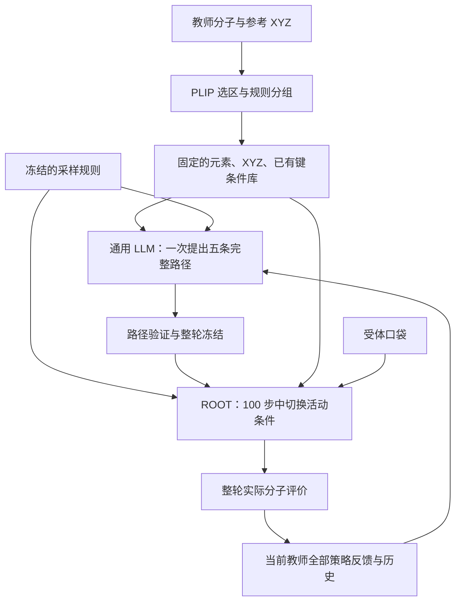

# DecompCond 与冻结通用 LLM 规划文献的架构比较

核查日期：2026-10-27。项目依据为提交 `61a064f` 的源码、配置与运行合同。远端活动运行 `multi-style-v1` 已核验使用已知原子网络时间 0.999、全局积分终点 0.999、`last_prediction`、初始自条件坐标缓存为零；主进程存在。以下区分已实现机制、文献机制及建议，不将新建议写成实验结果。

## 1. 当前项目的准确定位

DecompCond 是冻结 ROOT 生成器上的条件激活路径搜索：通用 LLM 在完整候选评价之后修订下一轮完整路径，程序在一条生成轨迹内按路径执行子条件开关。项目不对规划 LLM 追加 SFT、LoRA 或强化学习训练，ROOT 参数冻结。

当前有两个时间层级：

- **外层搜索：** 每位教师默认 10 轮；每轮一次提议 5 条完整路径，每条生成并评价 20 个候选，全部完成后才重新策划。
- **内层生成：** 每个候选执行 100 次更新，条件窗口长度为 10 的倍数；生成过程中不再次调用 LLM。下一候选重新从 ROOT 先验开始，跨轮继承历史和路径经验，不继承上轮候选的坐标或隐变量。

五条路径是一个规划器一次提出的五项试验，不代表五个独立 Agent 协商。两位教师各自保存基线、发现历史和优胜路径；当前规划调用不共享另一位教师的反馈。

实现定位：`conditions.compile_conditions`、`agent.DeepSeekPlanner.propose`、`paths.validate_batch`、`engine.Experiment.stage/run_teacher`、`backends.root.RootBackend.generate_batch`。

## 2. 与主要文献的差异

| 维度 | 当前 DecompCond | CoG | PROBE | LIDDIA / TRACE |
|---|---|---|---|---|
| LLM 的决策对象 | 已给定子条件的活动时间与组合 | 化学文本拆分、累积顺序 | 位点诊断、试探、局部编辑约束及协调 | 分子工具、目标或指令序列 |
| 条件表示 | 稳定原子 ID、元素、参考 XYZ、显式已有键 | 语义子提示及文本嵌入 | 编辑位点及语义片段约束 | 当前分子、性质目标、工具指令 |
| 分解来源 | PLIP 选区诱导图连通分量；可选 BRICS 投影 | LLM 语义分解 | BRICS 加诊断、位点选择 | 分解主要服务于编辑或工具执行 |
| 组合发生处 | 单条三维轨迹内的输入与状态覆盖 | 多阶段隐空间条件生成 | 外层化学片段修改与执行 | 多次工具调用 |
| 条件是否累积 | 可累积，也可撤下、重入或全空 | 主要逐阶段保留早期子提示 | 编辑约束及手册随反馈修订 | 根据当前分子和历史选择后续动作 |
| 何时重规划 | 上轮全部策略评价完成后 | 主要预先规划 | 试探后、编辑评价后 | 工具执行及评价后 |
| 跨阶段继承 | 同轨迹内继承状态；跨候选只继承上下文 | 后续阶段继承上一阶段隐变量 | 继承被编辑分子和手册 | 继承候选、动作历史或检索轨迹 |
| 主要验收对象 | 实际原子/键恢复与三维结构 | 文本到分子图的语义符合 | 亲和力与药物样性质等编辑收益 | 工具任务的性质及约束满足 |

**CoG 的直接参照价值在条件顺序，机制差异在于条件和采样单位。** 它采用累积子提示，后续阶段继承隐变量并执行部分去噪。DecompCond 在一条固定长度 ROOT 轨迹内使用非单调活动集合，当前没有每阶段重新加噪或续采样接口。CoG 的图解码和语义指标也不等于三维口袋中的物理有效性。[CoG §4.3–4.4](https://arxiv.org/html/2511.11894v1#S4.SS3)

**PROBE 的直接参照价值在诊断—试探—手册。** 它先用局部信号和受控编辑形成位点知识，再通过片段组装执行编辑。DecompCond 当前对候选轨迹做批量试验，尚没有同等形式的位点手册或显式冲突模型。这里适合借用受控试验组织方式，并将干预对象改为时间窗口和共激活集合。[PROBE §4、附录 C](https://arxiv.org/pdf/2606.00555v3)

**LIDDIA / TRACE 的直接参照价值在工具编排和记忆。** LIDDIA 在生成、优化和筛选动作之间选择；TRACE 进一步使用工具指令纠错和相似轨迹检索。当前 DecompCond 的生成与评价工具链固定，没有工具选择动作或跨任务轨迹检索库。[LIDDIA §3、§4.3](https://aclanthology.org/2025.emnlp-main.603.pdf)、[TRACE Algorithm 1、§5](https://arxiv.org/pdf/2605.28862v1)

训练边界仍须分别标明：CoG 的执行骨干另有训练和后对齐；TRACE 调用专门微调的 GeLLMo；M⁴olGen 第一阶段可参考，完整方法的第二阶段包含 ChemDFM 的 SFT/GRPO；MotifAgent 对共享策略骨干做 LoRA 和强化学习训练，不属于当前冻结通用规划 LLM 的主证据。[M⁴olGen §4.1](https://arxiv.org/html/2601.10131v2#S4.SS1)、[MotifAgent 附录 J.3.1](https://aclanthology.org/2026.findings-acl.2023.pdf)

## 3. 当前 sub-condition 的含义与几何自由度

当前子条件是目标事实的子集，不能自动视为可独立组装的完整药化片段。例如，孤立互作氧原子可以成为一个条件模块，但其官能团其余原子不一定属于选区。BRICS 投影也只改变既有选区的分组，不自动加入完整片段或一跳原子。

活动原子的元素和参考 XYZ 同时恢复，指定已有键按独立掩码恢复；关闭时停止覆盖，保留已形成状态和自条件缓存。每步都生成完整分子状态，没有把不同候选的局部几何拼接在一起。

因此当前的 soft 指**条件在时间上的可变激活**。活动窗口内采用参考值覆盖；关闭后允许调整。它没有连续软约束强度参数，也没有数学上的多条件 score 加权融合。若最后返回的原始模型预测偏离条件，代码不会再贴回教师值。

| 拟议的广义控制动作 | 当前能力 |
|---|---|
| 安排哪些子条件在何时生效 | 已实现，允许撤下、重入和空窗口 |
| 独立选择元素、键与坐标的活动区域 | 尚未实现；元素和 XYZ 绑定，键使用既定掩码 |
| 根据失败扩大可动邻域 | 尚未实现；关闭模块后释放该模块，其他未指定部分本来就可生成 |
| 改变局部加噪等级或继续上一候选 | 尚未实现；每候选重新从先验启动 |
| 动态改变候选数或积分预算 | 尚未实现；当前由配置冻结 |
| 回退到某个生成中间态重新分支 | 尚未实现；运行断点恢复用于防止重复任务，不是分子搜索回退 |
| 改写化学条件或重新分组 | 搜索期间不允许；当前 Agent 只改路径 |

该范围比用户提供的 PocketXMol 广义控制器更窄。若扩展活动区、噪声和回退，动作空间、状态保存及公平预算都需要新合同，不能只增加提示词便声称已经支持。

## 4. 当前目标与“完整条件联合成功”的区别

当前选路依据是结构合格候选的平均有效恢复贡献，亲和力变化只用于同分比较。代码分别记录 `structure_pass` 和 `exact_recovery`：结构合格并不要求全部选区原子与键都恢复；路径校验也没有规定每个子条件必须激活过，或最后必须启用全部条件。

这使平均收益可以通过放弃困难模块而改善。已完成的上一周期中，3w54 的溴模块在 49/50 条搜索路径中没有激活，960 个可化学评价搜索候选中仅恢复一次；该事实提示目标分配偏移，并不单独证明哪种时间安排有因果优势。证据见 `research-cycles/cycle02.zh-CN.md`。

如果研究问题是“全部指定化学信息与合理三维结构同时满足”，应将**结构合格且全部原子/键恢复的尝试比例**作为明确终点，与目前连续恢复得分并列报告，区分激活覆盖率、输出恢复率和联合成功率。是否改变选路规则需单独设计和版本化，不能事后改验收口径。

当前 PLIP 互作恢复属于分层诊断，而非硬条件本身；参考坐标偏移为诊断，没有坐标容差验收门槛。因此也不能把当前完全化学恢复解释为原互作、精确坐标或亲和力同时保持。

## 5. 最值得借鉴的改进与边界

以下为下一方法版本建议，没有在本次分析中改动执行代码或当前实验。

1. **加入解释性条件元数据。** 利用可读取的完整教师图描述模块的环、官能团、未指定连接边界，以及受体接触背景；只丰富 Agent 上下文，不扩大 inpainting 选区。当前规划请求有选区原子/XYZ/键和结果摘要，但没有完整受体局部几何或显式子条件依赖图。
2. **把早期路径安排为受控试探。** 在原定每轮五路径预算内，选择有代表性的模块撤下、共激活、顺序交换或暴露量匹配对照。优先分辨主效应和冲突，避免从多处同时变化的高分路径直接推断原因。所有试探都计入原定预算，不隐藏额外生成。
3. **建立每位教师自己的时序条件手册。** 每条规则保存适用模块/组合、时间窗口、支持与反例、样本数、暴露量混杂和采样合同哈希。参考 PROBE 的手册思想，但这里记录“何时激活条件”，而不是允许或禁止化学片段编辑。
4. **区分固定指引与更新记忆。** 当前技能文件按哈希冻结，历史作为上下文变化。后续可以预先定义手册更新流程，让每轮手册成为有来源的输入数据；不需要训练 LLM，也不应通过运行期间改写技能文件绕过冻结合同。
5. **优先完善失败归因，再扩动作。** 原子/键命中、末段恢复、重入位移和局部碰撞证据更直接支持时间安排；现有全局结构失败布尔项不足以唯一归因到某个模块。允许轨迹中途诊断、局部噪声或回退属于进一步扩展，需单独验证。

## 6. 能支持研究结论的对照

当前差异值得检验，但“通用 LLM 负责规划”本身已有多项先例。更明确的问题是：**在同一冻结三维生成器、同一条件事实、同一采样合同及相同预算下，反馈驱动的非单调子条件时间安排，是否提高未见种子上的联合成功率？**

必要对照包括全程完整条件、CoG 启发的单调累积与逆序、随机合法路径、基于相同指标的规则或搜索控制器，以及没有反馈的预先规划。论文原始实现更换生成器、表示或预算时只能作为外部方法对照；DecompOpt 的参考片段重组也不能直接等同于当前的活动掩码动作空间。

进一步拆开比较：是否分解、是否切换、是否允许释放/重入、是否读取反馈、是否使用手册。已知时间、读出、积分终点及初始缓存的改变属于采样方法变量，不能归为 LLM 收益。搜索复用发现种子便于配对比较；独立确认使用新的种子，并分别按教师报告。

`0.999` 与最后预测读出是当前采样合同，不是上述 Agent 文献共同要求的架构。它们能够影响结构有效性，须先确保静态基线可运行，再评价规划增益。真实小规模接口验证已经完成；统计效力和泛化结论仍由正式结果决定。
